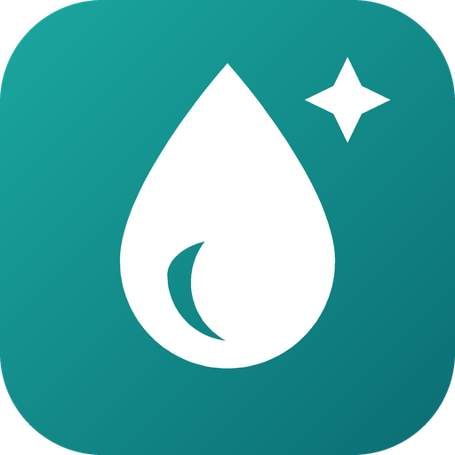
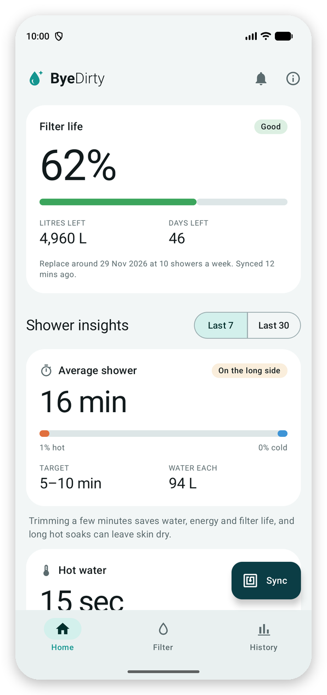
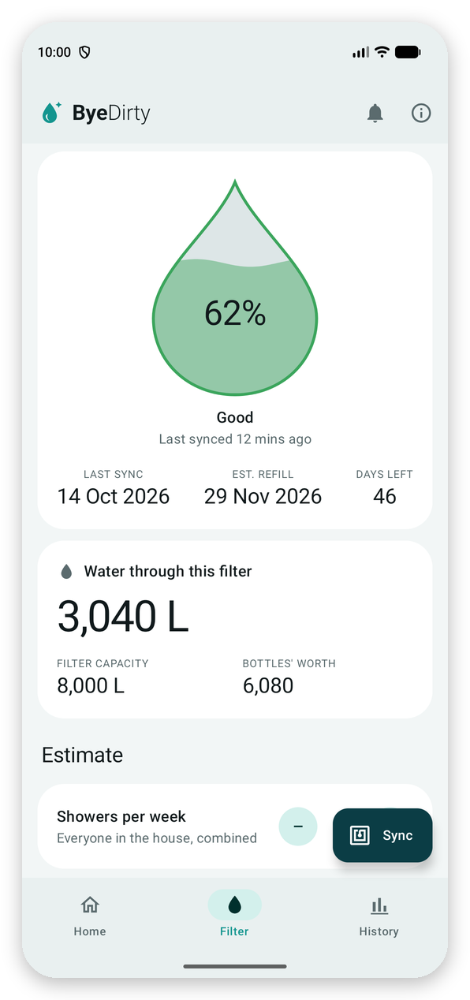
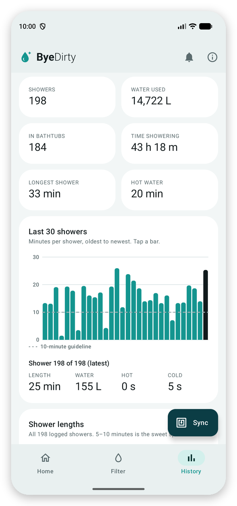
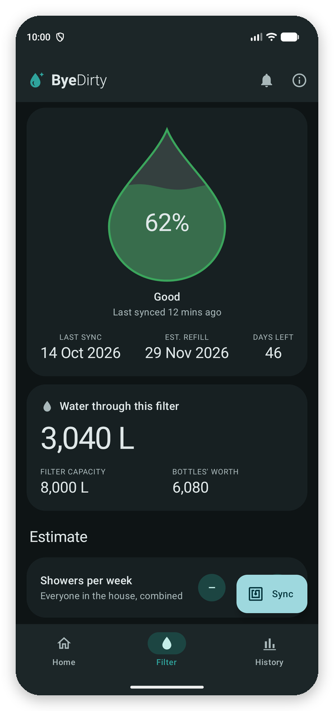
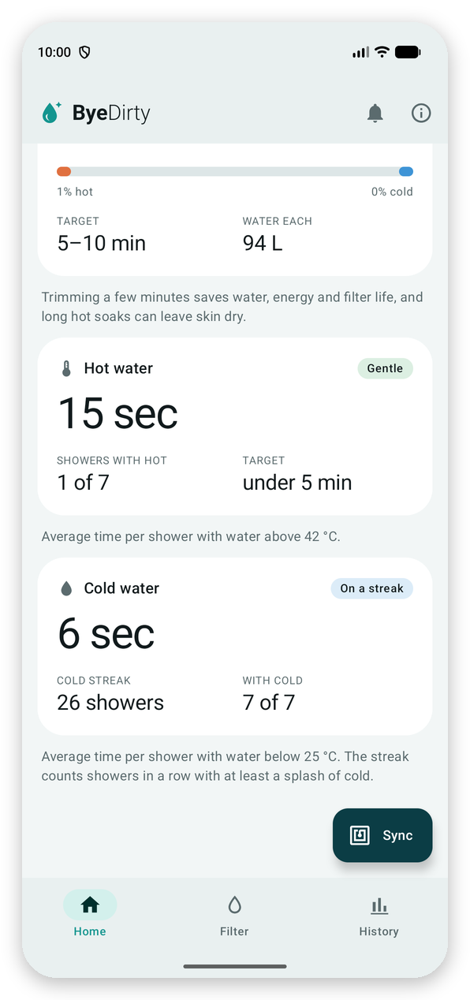

<p align="center"></p>

<h1 align="center">ByeDirty</h1>

<p align="center">An Android app for Hello Klean smart shower heads: filter life, replacement reminders and shower
insights, read straight from the shower head over NFC.</p>

<p align="center">
  
  
  
</p>

> **Alpha.** ByeDirty is a personal project under active development.

> [!IMPORTANT]
> **ByeDirty is an independent, unofficial app.** It isn't made, endorsed or supported by Hello Klean. "Hello
> Klean" is a trademark of its owner and is only used here to say which shower heads the app works with.

## What is it

Hello Klean's smart shower heads track how much water has gone through the filter and log every shower to an
NFC tag in the handle. The official companion app that reads it is iPhone-only. ByeDirty reads the same tag
on Android: hold your phone to the handle and you get the same numbers.

## Motivation

We have one of these shower heads in an Android household, and the Android app has been "coming" for a couple of
years. Knowing when to change the filter shouldn't need a borrowed iPhone. ByeDirty is for everyone else in
the same spot.

## Features

### Filter life

<p align="center">
  
  
</p>

- **Percentage and litres left** come straight from the shower head, so they agree with what it tracks itself.
- **Days left and a replacement date:** based on your average litres per shower and how many showers your
  household takes a week. After a few days of syncing, ByeDirty switches to your real usage.
- **A reminder** notification a few days before the filter is due.
- **New filter?** Hold the reset button on the shower head as usual; ByeDirty notices on the next sync.

### Shower insights

For the last 7 or 30 showers:
- average shower length, with how much of it was hot or cold water;
- time with hot water (above 42 °C) and with cold water (below 25 °C);
- your cold streak.

They're calculated the same way as the official app, so the numbers match.

### History

- **Totals:** water used, time spent showering, your longest shower.
- **Charts:** a bar chart of your last 30 showers (tap one for its details), a histogram of shower lengths and
  your water-pressure split.
- **Kept on your phone:** ByeDirty keeps every shower it has seen, beyond the last 256 that the shower head
  remembers.

### And

- Sync from the app, or tap the handle with the app closed to open it.
- Light and dark themes.
- Read-only: ByeDirty never writes to the shower head.
- No accounts and no internet access; your data stays on your phone.

See [CHANGELOG.md](CHANGELOG.md) for what's in each release.

## Compatibility

- **Shower heads:** Hello Klean smart shower heads with the NFC tag in the handle, model `HKSSH001`. It's the
  only model tested so far; if yours is different, see [Help with other models](#help-with-other-models).
- **Phones:** Android 8.0 or later, with NFC.

## Install

1. On your phone, download the latest `ByeDirty-<version>.apk` from
   [Releases](https://github.com/Snivik/ByeDirty/releases).
2. Open it. The first time, Android asks you to allow installs from your browser or file manager.
3. Open ByeDirty, tap **Sync** and hold the back of your phone against the shower head handle until it vibrates.
   The first sync reads the whole log, so keep still for a few seconds.

Every release is signed with the same key, so new versions install over old ones and keep your history.
A Google Play listing is planned.

### Build it yourself

You need JDK 17 or later and the Android SDK (Android Studio has both).

- **In Android Studio:** open the project and run the `app` configuration on your phone.
- **From the command line:**

```bash
./gradlew :app:assembleDebug
```

The APK ends up in `app/build/outputs/apk/debug/`.

## Releases

Every push to `main` runs the tests on GitHub Actions ([.github/workflows/ci.yml](.github/workflows/ci.yml)).

- **Releasing:** when a push adds a new version section at the top of [CHANGELOG.md](CHANGELOG.md), CI:
  - builds a signed release APK;
  - tags it `v<version>`;
  - publishes a pre-release with that section as its notes.
- **Versions:** fix releases bump the patch (0.1.0 → 0.1.1); significant new features bump the minor (→ 0.2.0).
  - `Tools/changelog.sh next` (or `next minor`) prints the next version.
  - Pushes without a new section only run the tests.

Signing: the `BYEDIRTY_KEYSTORE_BASE64`, `BYEDIRTY_KEYSTORE_PASSWORD`, `BYEDIRTY_KEY_ALIAS` and
`BYEDIRTY_KEY_PASSWORD` repository secrets hold the release key. Locally, an untracked `signing.properties` with
the same keys (without the `BYEDIRTY_` prefix, and `KEYSTORE` as a file path) signs `assembleRelease`.

## How it works

The shower head writes its settings, counters and a log of the last 256 showers to an ST25DV64K NFC chip.
[docs/PROTOCOL.md](docs/PROTOCOL.md) has the full memory map and how the official app's numbers are
calculated from it.

### Help with other models

On the info screen (ⓘ), **Collect data** saves a labelled full scan of the chip. **Share** sends the scans as
text files. To get a different model or firmware supported, open an issue with a scan taken before and after
a shower.

## Development

- **Tests:** `./gradlew :app:testDebugUnitTest`. The decoder is tested against real scans in
  `app/src/test/resources`.
- **Screenshots:** the images in `docs/screenshots/` come from the emulator with a real shower log. Only the
  filter level was set to 62% so the gauge has something to show.
